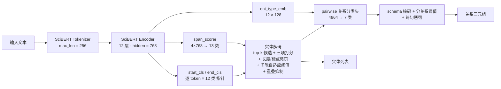

[README.md](https://github.com/user-attachments/files/33327932/README.md)
# 作物育种文本实体关系联合抽取（SciBERT · NER + RE）


> 输入一段作物遗传育种的英文文献文本，输出其中 **12 类命名实体** 与 **6 类语义关系**。
> 单模型、多任务、端到端：一个 SciBERT 编码器 + 四个预测头，同时完成命名实体识别（NER）与关系抽取（RE）。
> 全部流程（数据处理 → 训练 → 阈值标定 → 推理 → 指标评测）由仓库内两个脚本自包含实现，共 1158 行代码。

**English abstract** — A single-model multi-task pipeline for joint NER (12 entity types) and relation extraction
(6 semantic relations) over crop-breeding literature, built on `allenai/scibert_scivocab_uncased`.
The model combines per-token start/end pointers (Dice+BCE), a span-level scorer (4×768 → 13 classes) and a
pairwise relation classifier (4864 → 7 classes) with a type-constraint schema mask, plus a domain-tuned
decoding strategy (top-k span candidates, length/punctuation penalties, gap-based dynamic threshold,
overlap suppression, per-relation confidence thresholds, cross-sentence penalty).

---

## 目录

- [1. 项目在做什么](#1-项目在做什么)
- [2. 任务定义](#2-任务定义)
- [3. 数据集](#3-数据集)
- [4. 模型架构](#4-模型架构)
- [5. 训练策略](#5-训练策略)
- [6. 解码与后处理（工程核心）](#6-解码与后处理工程核心)
- [7. 项目结构与运行方式](#7-项目结构与运行方式)
- [8. 实验结果](#8-实验结果)
- [9. 误差来源分析](#9-误差来源分析)
- [10. 已知问题与改进方向](#10-已知问题与改进方向)

---

## 1. 项目在做什么

面向**杂粮作物（谷子、高粱、大麦等）育种文献**的信息抽取任务，把非结构化的自然语言文本转化为结构化的
`(实体, 关系)` 知识三元组。以测试集中的一条真实样本为例：

**输入文本**

> Waxy sorghum seeds have reduced amylose content in starch. A nonfunctional waxy (wx) allele causes waxy
> endosperms by the absence of granule-bound starch synthase enzyme in sorghum.

**期望输出（金标标注）**

| 实体 | 类型 |
|---|---|
| Waxy sorghum seeds | VAR（品种） |
| sorghum | CROP（作物） |
| reduced amylose content in starch | TRT（性状） |
| waxy endosperms | TRT（性状） |
| waxy (wx) allele | GENE（基因） |

| 头实体 | 关系 | 尾实体 |
|---|---|---|
| sorghum (CROP) | `CON` 包含 | waxy (wx) allele (GENE) |
| waxy (wx) allele (GENE) | `AFF` 影响 | waxy endosperms (TRT) |
| Waxy sorghum seeds (VAR) | `HAS` 具有 | reduced amylose content in starch (TRT) |

整个仓库解决的就是这一类问题：**一段文本进，实体列表 + 关系三元组出**，并按竞赛口径
（Precision / Recall / F1 加权）给出可复现的量化评分。

**项目亮点**

| 维度 | 内容 |
|---|---|
| 建模 | 单编码器 + 4 头多任务联合训练，NER 与 RE 共享同一份 SciBERT 表示 |
| 损失 | Dice+BCE 双损失处理极端类别不平衡，跨度打分头做二次判别，关系头带类型约束掩码 |
| 解码 | top-k 候选 + 长跨度惩罚 + 标点惩罚 + 分数间隙自适应阈值 + 同类重叠抑制 + 跨句惩罚 |
| 标定 | 在验证集上按关系类型网格搜索最优置信度阈值，落盘 `rel_thresholds.json` |
| 评测 | 内置 P/R/F1/竞赛 Score 计算与分类型、分关系细分报告，训练全程按 Total Score 早停保存最优 |
| 可复现 | 全局固定随机种子（42）+ `cudnn.deterministic` + 逐 epoch 重播种，训练结果可复现 |

---

## 2. 任务定义

### 2.1 命名实体识别（NER）：12 类实体

| 类型 | 英文（缩写） | 说明 | 示例 |
|---|---|---|---|
| 作物 | Crop (CROP) | 杂粮作物的物种或类别名称 | 谷子 / sorghum |
| 品种 | Variety (VAR) | 审定/登记/推广的具体品种名称或代号 | 晋谷21 / RTx430 |
| 性状 | Trait (TRT) | 表型/农艺/品质/抗性等性状名称 | 株高、千粒重 / grain size |
| 生育时期 | Growth Stage (GST) | 作物生长发育阶段节点 | 出苗期、拔节期 / anthesis |
| 基因 | Gene (GENE) | 与性状相关的功能基因/候选基因 | Waxy / waxy (wx) allele |
| 数量性状位点 | QTL (QTL) | 与数量性状相关的遗传位点/区间 | qPH3.1 / qSC1-1 |
| 分子标记 | Marker (MRK) | 用于定位/选择的 SSR/SNP/Indel/KASP 标记 | SSR-Xgwm20 / SNP markers |
| 染色体 | Chromosome (CHR) | 染色体编号或名称 | Chr1 / chromosomes 1H |
| 育种方法 | Method (BM) | 育种或选择的技术路线/方法 | 杂交育种 / GWAS、RNA-Seq |
| 亲本/杂交组合 | Cross (CROSS) | 父本/母本材料及其杂交组合表达 | A×B |
| 非生物胁迫 | Abiotic Stress (ABS) | 非生命因素引起的胁迫条件 | 干旱胁迫 / drought stress |
| 生物胁迫 | Biotic Stress (BIS) | 生物因素引起的胁迫类型 | 螟虫、蚜虫 |

### 2.2 关系抽取（RE）：6 类语义关系与类型约束

关系抽取被建模为**带 schema 约束的配对分类**。代码中的 `RELATION_TYPE_CONSTRAINTS` 明确定义了每种关系
允许的头/尾实体类型组合，不满足约束的实体对在推理阶段被直接掩掉（logit 置 `-1e9`），既提升精度又省算力：

| 关系 | 缩写 | 合法头/尾类型组合 | 含义 |
|---|---|---|---|
| 包含 | `CON` | CROP→VAR, CROP→CROP | 归属、从属、别名、学名/俗名、同位说明 |
| 采用 | `USE` | VAR→BM, CROSS→BM | 采用/借助/通过某方法、材料进行分析、筛选、育种、检测 |
| 具有 | `HAS` | VAR→TRT, CROP→TRT, CROSS→TRT | 表现出、具备、拥有某性状 |
| 影响 | `AFF` | {ABS, GENE, MRK, QTL, BIS}→TRT | 影响、调控、促进、抑制、响应、抗性等方向性作用 |
| 发生于 | `OCI` | {TRT, ABS, BIS}→GST | 发生于、测定于、调查于某生育时期 |
| 定位于 | `LOI` | {MRK, QTL, GENE}→CHR | 定位、映射、连锁、位于、关联等分子证据关系 |

### 2.3 数据格式

```jsonc
{
  "text": "Waxy sorghum seeds have reduced amylose content in starch. ...",
  "entities": [
    { "start": 0, "end": 18, "text": "Waxy sorghum seeds", "label": "VAR" }
  ],
  "relations": [
    { "head": "Waxy sorghum seeds", "head_start": 0, "head_end": 18, "head_type": "VAR",
      "tail": "reduced amylose content in starch", "tail_start": 24, "tail_end": 57,
      "tail_type": "TRT", "label": "HAS" }
  ]
}
```

- 字符级偏移，`start` 含、`end` 不含；实体与关系端点均用 `(start, end, type)` 三元组严格匹配才算正确。
- 实体的字符区间由 tokenizer 的 `offset_mapping` 映射为 token 区间参与训练，字符级对齐逻辑与语言无关
  （本仓库权重在英文语料上训练，中文语料需重新训练）。

### 2.4 评价标准

$$\text{Score}_{\text{NER}} = 0.5 \times F1 + 0.25 \times P + 0.25 \times R \qquad
\text{Score}_{\text{RE}} = 0.5 \times F1 + 0.25 \times P + 0.25 \times R$$

$$\text{Total Score} = 0.4 \times \text{Score}_{\text{NER}} + 0.6 \times \text{Score}_{\text{RE}}$$

F1 权重最高（0.5），因此解码策略整体偏向"高精度且不漏"的平衡点；RE 在总分中占 0.6，是分数的主要来源。

---

## 3. 数据集

| 划分 | 样本数 | 文本平均字符数 | 实体总数 | 关系总数 | 实体/样本 | 关系/样本 |
|---|---|---|---|---|---|---|
| 训练集 `HW_train_data.json` | 800 | 252.0（最长 619） | 4,922 | 1,871 | 6.2（最多 27） | 2.3（最多 24） |
| 测试集 `HW_test_data.json` | 200 | 257.2（最长 639） | 1,306 | 474 | 6.5（最多 20） | 2.4（最多 18） |

**实体类型分布**（训练 / 测试，个）

| 类型 | TRT | GENE | CROP | VAR | ABS | QTL | BM | CHR | MRK | BIS | GST | CROSS |
|---|---|---|---|---|---|---|---|---|---|---|---|---|
| 训练 | 1417 | 722 | 610 | 557 | 418 | 355 | 263 | 216 | 161 | 86 | 71 | 46 |
| 测试 | 380 | 218 | 165 | 146 | 114 | 78 | 68 | 49 | 43 | 21 | 12 | 12 |

**关系类型分布**（训练 / 测试，个）

| 关系 | LOI | AFF | CON | HAS | USE | OCI |
|---|---|---|---|---|---|---|
| 训练 | 568 | 545 | 363 | 249 | 93 | 53 |
| 测试 | 96 | 147 | 90 | 94 | 32 | 15 |

数据特征与建模难点：

- **长尾严重**：TRT 占比 29%，而 CROSS/GST/BIS 在测试集中仅 12/12/21 个实例，稀有类极易被模型忽略。
- **实体长度跨度大**：字符长度均值 12.0、中位数 11、P90 23、最长 101，跨度边界定位（尤其长性状名）是主要难点。
- **文本短**：经 SciBERT tokenizer 后，训练集平均仅 56.5 token、最长 221 token（测试集平均 57.2、最长 184），`max_len=256` 下**无任何样本被截断**，因此指标不受截断影响。
- **关系头尾类型组合有 110 种**（训练集），远超 6 种关系本身，说明同一种关系在不同实体类型组合下语义差异明显 —— 这正是引入 `ent_type_emb` 与类型约束掩码的动机。

---

## 4. 模型架构



模型共 **125.7M 参数**（SciBERT 主干 110M + 预测头），`best_model.pt` 为纯 `state_dict`（220 个张量）。

### 4.1 四个预测头

| 组件 | 输入 | 输出 | 作用 |
|---|---|---|---|
| `start_cls` | token 表示 768 | 12（每个实体类型一个起点概率） | 预测实体起始边界 |
| `end_cls` | token 表示 768 | 12（每个实体类型一个终点概率） | 预测实体结束边界 |
| `span_scorer` | span 表示 4×768 | 13（12 类实体 + 1 类非实体） | 对"起点终点都高分但整体不是实体"的假阳性做二次判别 |
| `rel_cls` | 配对表示 4864 | 7（6 类关系 + NA） | 判定实体对之间的关系类型 |

### 4.2 特征构造

- **实体 span 表示**（用于关系分类）：`[h_start, h_end, mean(h_start..h_end)]` → 3×768。
- **span 打分表示**：`[h_start, h_end, mean, h_start ⊙ h_end]` → 4×768。
  拼接首尾表示捕捉边界信息、均值捕捉整体语义、逐元素乘积显式建模首尾交互。
- **关系配对表示**（4864 维）：

  `[head_span(2304), ent_type_emb(head_type)(128), tail_span(2304), ent_type_emb(tail_type)(128)]`

  即 `hidden×6 + 128×2 = 4608 + 256 = 4864`，与代码中 `rel_in_dim` 一致；实体类型用可学习嵌入显式注入，
  让模型能区分"同一对文本跨度在不同类型假设下的关系差异"。

- **双向配对**：`(i, j)` 与 `(j, i)` 都会生成候选，因此 `AFF`、`HAS` 等有方向的关系可以被正确建模。

---

## 5. 训练策略

### 5.1 多任务损失

$$
\mathcal{L} = \underbrace{\mathcal{L}_{\text{DiceBCE}}(start) + \mathcal{L}_{\text{DiceBCE}}(end)}_{\text{边界检测}}
+ 0.5 \cdot \underbrace{\mathcal{L}_{\text{CE}}(span)}_{\text{跨度二次判别}}
+ 0.4 \cdot \underbrace{\mathcal{L}_{\text{CE}}(rel)}_{\text{关系分类}}
$$

- **`DiceBCE`**：`0.5 × 加权 BCE(pos_weight=5.0) + 0.5 × Dice Loss`。
  NER 中正样本 token 占比极低，纯 BCE 会让模型倾向全预测为 0；加权 BCE 提升正样本权重，
  Dice 直接优化预测集合与标注集合的重合度，两者互补。
- **span scorer 负采样**：每个正样本采样 3 倍负 span（上限 64），负样本从"不与任何金标实体重叠"的随机跨度中生成；
  非实体类损失权重设为 0.3，避免负样本主导。
- **关系头负采样**：`neg_sample_ratio=2`（负例 = 2 × 正例，下限 16），NA 类损失权重 0.1。
- **数据到 token 的标注转换**：实体/关系字符区间通过 `offset_mapping` 映射为 token 区间，
  超过 `max_span_len=20` 的跨度过长样本在训练时跳过，保证标签质量。

### 5.2 超参数

| 参数 | 值 | 说明 |
|---|---|---|
| 预训练模型 | `allenai/scibert_scivocab_uncased` | 科学文献语料预训练的 BERT-base |
| batch size | 8 | |
| max_len | 256 | 实测无样本被截断 |
| learning rate | 3e-5 | AdamW，weight decay 0.01 |
| 调度器 | Cosine + 10% warmup | 不可用时自动回退线性调度 |
| epochs / patience | 50 / 12 | 按验证集 Total Score 早停 |
| grad clip | 2.0 | 梯度裁剪，NaN/Inf 步直接跳过 |
| dropout | 0.15 | 所有预测头 |
| max_span_len | 20 | 实体跨度 token 上限 |
| topk_start_end | 15 | 每类型保留的起/终点候选数 |
| max_ent_per_type | 5 | 每类型实体数上限 |
| ner_score_thresh | 0.06 | 动态阈值下限 |
| rel_conf_thresh | 0.75 | 关系置信度默认阈值（可被 `rel_thresholds.json` 覆盖） |
| ent_type_emb_dim | 128 | 实体类型嵌入维度 |
| span_len_penalty | thresh=4, power=0.6 | 长跨度惩罚 |
| 随机种子 | 42 | 全局固定，`cudnn.deterministic=True` |

### 5.3 可复现性设计

- `random / numpy / torch / cuda` 全部固定种子，并设置 `torch.use_deterministic_algorithms(True, warn_only=True)`。
- DataLoader 使用带种子的 `generator` 与 `worker_init_fn`。
- **每个 epoch 重新播种**（`SEED + epoch`），使数据顺序与负采样序列完全确定。
- 验证/测试集划分由 `random.seed(42)` + `random.shuffle` 决定，训练/验证 = 720 / 80，跨机器结果一致。

### 5.4 关系阈值自动标定

训练结束后，脚本在验证集上按**关系类型**分别网格搜索最优置信度阈值（0.5 ~ 0.9 共 9 档，以该关系的 F1 为目标），
结果写入 `rel_thresholds.json`，推理脚本启动时自动加载。这样每种关系可以拥有自己的判定门槛，
避免稀有且难判的关系被统一阈值误伤。文件缺失时回退到全局 `rel_conf_thresh=0.75`。

---

## 6. 解码与后处理（工程核心）

模型的原始输出是逐 token 的起止概率和逐配对的关系 logits，直接取 argmax 会产生大量碎片实体与虚假关系。
本项目实现了一套面向该领域数据的解码流水线：

**① 候选生成**

对每个实体类型，在有效 token 上分别取 start / end 概率的 top-15，做笛卡尔积并保留满足
`s ≤ e` 且 `e - s < 20` 的跨度作为候选。

**② 三路打分**

$$\text{score}(s,e,t) = P_{\text{start}}(s,t) \times P_{\text{end}}(e,t) \times P_{\text{span}}(t \mid s,e)$$

起点、终点、跨度整体判别的概率相乘，任一环节不自信都会被显著压低，"首尾各自高分但整体不成实体"的假阳性被有效抑制。

**③ 长度惩罚**

$$\text{score} \mathrel{*}= \left(\frac{4}{n_{\text{token}}}\right)^{0.6},\quad n_{\text{token}} > 4$$

专门针对"模型为了包住正确实体而给出过长跨度"的问题（长性状名、并列短语），让短跨度在分数接近时胜出。

**④ 标点抑制**

跨度内部每出现一个 `, : ; . !`，分数乘以 0.7。含有句末标点的跨度几乎必为拼接错误，因此被强烈压制
（训练脚本的解码版本在此之上还有一条：跨度内出现 `.` 或 `!` 时额外乘 0.3）。

**⑤ 自适应动态阈值**

对排序后的候选分数计算相邻差值，取**最大间隙**所在的分数作为阈值（下限 0.06）；
若最高分低于 0.005 则直接放行全部候选。这样阈值随样本难度自适应，而不是全局硬编码。
（训练脚本中的变体略有不同：取分数序列约 20% 分位处的分数作为阈值，最高分低于 0.01 时取消阈值。）

**⑥ 重叠抑制与配额**

同类实体若与已选实体重叠比例 > 0.3 则丢弃；每个实体类型最多保留 5 个实体。由于计数按类型独立，
不同类实体可以共享同一段文本（如 `drought` 同时被判为 ABS 和 TRT 时不会互相压制）。

**⑦ 关系解码与约束**

- 对预测出的实体做**双向全配对**，仅保留满足 `RELATION_TYPE_CONSTRAINTS` 的类型组合（不合法组合不建候选，直接省算力）。
- 关系头输出 7 维 logits，按合法性构造掩码（不合法置 `-1e9`）后取 argmax，从根本上杜绝
  "CROP—CHR 之间预测出 LOI" 这类 schema 违规。
- 置信度低于**该关系的专属阈值**（`rel_thresholds.json`）则丢弃。
- **跨句惩罚**：若头尾实体之间存在 `.` / `!` / `?`，置信度乘以 0.3 的句数幂 —— 跨句关系绝大多数是错的，
  该策略对 `LOI`（定位于）尤其有效（错误的配对从 70 个降到 26 个）。

---

## 7. 项目结构与运行方式

### 7.1 目录结构

脚本按相对路径定位数据（`_THIS_DIR.parents[1]`，不依赖任何硬编码盘符），实际布局如下：

```
pytorch/                          # 项目根（脚本中的 _PROJECT_ROOT）
├── data/
│   ├── HW_train_data.json        # 800 条训练数据
│   ├── HW_test_data.json         # 200 条测试数据（含金标，可算指标）
│   └── 数据说明.md                # 任务/标签/评价标准说明
└── nndl/
    └── EntityRelation/
        ├── 实体关系识别.py         # 训练 + 阈值标定 + 测试推理（791 行）
        ├── best_model.py          # 载入权重 + 推理 + 完整指标报告（367 行）
        ├── best_model.pt          # 训练完成的权重（125.7M 参数，约 479 MiB）
        └── rel_thresholds.json    # 关系阈值（由训练脚本自动生成，可选）
```

> 若把 `EntityRelation/` 单独作为仓库根目录，需要相应调整两个脚本中 `Config` 里的数据路径
> （`_PROJECT_ROOT` 的计算方式，或直接把 `train_file` / `test_file` 改成绝对/相对路径）。

### 7.2 环境依赖

```bash
python -m venv .venv && source .venv/bin/activate
pip install torch transformers numpy
```

实测环境：**Python 3.12 · PyTorch 2.9.0+cu128 · Transformers 5.17.0 · NumPy 2.2.6 · CUDA 12.8（RTX 5060 Laptop 8 GB）**，
CPU 亦可运行（脚本自动选择 `cuda` / `cpu`）。首次运行会从 Hugging Face 下载 `allenai/scibert_scivocab_uncased`
（本机缓存约 422 MB）；若已缓存或需要离线运行，可设置：

```bash
export HF_HUB_OFFLINE=1     # 仅用本地缓存
# 若环境里配置了 socks 代理导致 httpx 报 Unknown scheme for proxy URL，可临时清除代理变量：
unset ALL_PROXY all_proxy HTTP_PROXY HTTPS_PROXY
```

### 7.3 训练

```bash
python nndl/EntityRelation/实体关系识别.py
```

流程：加载数据 → 9:1 划分训练/验证 → 多任务训练（每个 epoch 打印 NER / RE / Total 指标）→
按 Total Score 保存最优权重与早停 → 在验证集上标定关系阈值 → 对测试集推理并导出 `test_predictions_v2.json`。

### 7.4 评估（复现本文所有指标）

```bash
python nndl/EntityRelation/best_model.py
```

该脚本加载 `best_model.pt`，在 200 条测试集上逐条推理，打印前 5 条与后 5 条的预测/金标对照，
并输出 NER、RE 的 P/R/F1/Score、TP/FP/FN 汇总以及分实体类型的指标明细。

### 7.5 发布到 GitHub 的注意事项

`best_model.pt` 约 **479 MiB**，超过 GitHub 单文件 100 MB 的硬限制，直接 `git push` 会被拒绝。可选方案：

```gitignore
# .gitignore
__pycache__/
*.pyc
best_model.pt          # 用 Git LFS 或 Release 附件分发
test_predictions_v2.json
```

- **Git LFS**：`git lfs install && git lfs track "*.pt"` 后再提交；
- 或把权重作为 **Release 附件**，README 中给出下载链接与本脚本期望的存放路径。

---

## 8. 实验结果

以下为**本仓库当前权重 `best_model.pt` 在 `HW_test_data.json`（200 条）上的实测结果**，
由 `python nndl/EntityRelation/best_model.py` 一条命令复现（NVIDIA RTX 5060 Laptop，CUDA）。

```bash
python nndl/EntityRelation/best_model.py
```

### 8.1 总体指标

| 任务 | Precision | Recall | F1 | Score = 0.5·F1 + 0.25·P + 0.25·R | TP | FP | FN |
|---|---|---|---|---|---|---|---|
| **NER** | 0.7457 | 0.5926 | 0.6604 | **0.6648** | 774 | 264 | 532 |
| **RE** | 0.3391 | 0.1245 | 0.1821 | **0.2069** | 59 | 115 | 415 |
| **Total** | — | — | — | **0.3901** | | | |

- NER：预测实体 1,038 个 / 金标实体 1,306 个，精确率明显高于召回率，说明模型"敢报的都八九不离十"，
  主要失分在**漏检**而非误检。
- RE：预测关系 174 条 / 金标关系 474 条，关系抽取是当前流水线的短板（详见第 9 节分析）。

### 8.2 分实体类型指标（NER）

| 类型 | P | R | F1 | TP | FP | FN | 测试集金标数 |
|---|---|---|---|---|---|---|---|
| CROP | 0.8662 | 0.8242 | **0.8447** | 136 | 21 | 29 | 165 |
| GENE | 0.8095 | 0.7018 | **0.7518** | 153 | 36 | 65 | 218 |
| ABS | 0.7345 | 0.7281 | **0.7313** | 83 | 30 | 31 | 114 |
| GST | 0.8750 | 0.5833 | **0.7000** | 7 | 1 | 5 | 12 |
| TRT | 0.7778 | 0.6263 | **0.6939** | 238 | 68 | 142 | 380 |
| VAR | 0.7312 | 0.4658 | 0.5690 | 68 | 25 | 78 | 146 |
| BM | 0.5085 | 0.4412 | 0.4724 | 30 | 29 | 38 | 68 |
| CHR | 0.5000 | 0.4082 | 0.4494 | 20 | 20 | 29 | 49 |
| QTL | 0.5435 | 0.3205 | 0.4032 | 25 | 21 | 53 | 78 |
| MRK | 0.5185 | 0.3256 | 0.4000 | 14 | 13 | 29 | 43 |
| CROSS | 0.0000 | 0.0000 | 0.0000 | 0 | 0 | 12 | 12 |
| BIS | 0.0000 | 0.0000 | 0.0000 | 0 | 0 | 21 | 21 |

观察：**作物/基因/胁迫/性状**等高频且形态规整的类型表现最好（F1 0.69 ~ 0.84）；
**QTL / MRK / CHR** 等由编号、代号构成的类型召回偏低（命名无规律、与上下文强耦合）；
**CROSS（杂交组合）与 BIS（生物胁迫）在测试集上 F1 = 0**，原因是训练样本极少（46 / 86 个）
且测试集中分别只有 12 / 21 个实例，模型几乎没有学到这两类的表示 —— 这是最直接的改进空间。

### 8.3 分关系类型指标（RE）

| 关系 | P | R | F1 | TP | FP | FN | 测试集金标数 |
|---|---|---|---|---|---|---|---|
| AFF | 0.3953 | 0.2313 | **0.2918** | 34 | 52 | 113 | 147 |
| OCI | 0.3333 | 0.1333 | 0.1905 | 2 | 4 | 13 | 15 |
| CON | 0.3571 | 0.1111 | 0.1695 | 10 | 18 | 80 | 90 |
| HAS | 0.3182 | 0.0745 | 0.1207 | 7 | 15 | 87 | 94 |
| LOI | 0.1875 | 0.0625 | 0.0937 | 6 | 26 | 90 | 96 |
| USE | 0.0000 | 0.0000 | 0.0000 | 0 | 0 | 32 | 32 |

观察：`AFF`（影响）是唯一 F1 接近 0.3 的关系，其"基因/胁迫 → 性状"的模式在语料中表达最规整；
`LOI`（定位于）虽然约束最明确，但染色体编号与 QTL/标记代号本身就被 NER 大量漏检，
误差沿流水线放大；`USE`（采用）在测试集上完全未召回，训练样本仅 93 条是主因。

---

## 9. 误差来源分析

为定位 RE 分数偏低的原因，在测试集上做了四组离线对照实验（导出全部关系候选后统计）：

| # | 实验 | 目的 | P | R | F1 |
|---|---|---|---|---|---|
| 1 | 端到端 + 默认阈值 0.75（即第 8 节配置） | 基线 | 0.3391 | 0.1245 | 0.1821 |
| 2 | 把关系置信度阈值从 0 扫到 0.95（步长 0.05） | 阈值是否瓶颈 | 0.18 ~ 0.23 | 0.14 ~ 0.18 | **0.1748 ~ 0.1845** |
| 3 | 在验证集上按关系类型分别网格搜索最优阈值 | 阈值标定的收益 | 0.1985 | 0.1709 | 0.1837 |
| 4 | **用金标实体替换预测实体**，仅跑关系头 | 隔离 NER 误差 | 0.3333 | 0.4198 | **0.3716** |

**结论一：阈值不是瓶颈。** 阈值从 0 扫到 0.95，RE F1 始终在 0.17 ~ 0.18 之间波动（最好仅 0.1845）；
在验证集上精心标定的分关系阈值只把测试 F1 从 0.1821 提升到 0.1837。原因在于模型**严重过自信且缺乏校准**：
正确候选的平均置信度为 0.949，错误候选也有 0.897，两者几乎不可分，因此任何单一阈值都无法有效区分对错。
（这也是 `rel_thresholds.json` 缺失时结果几乎不受影响的原因。）

**结论二：NER 的端点精度是端到端 RE 的硬上限。** 474 条金标关系中，只有 **166 条（35.0%）** 的两个端点在实体预测
结果中以完全一致的边界和类型同时出现 —— 也就是说，即使关系判别完全正确，端到端 RE 的召回率上限也只有 0.35。
关闭置信度筛选（阈值取 0）时，流水线在可达集合中召回 86 条（约 52%）；采用默认配置时为 59 条（约 36%），
其余损失来自关系判别本身。

**结论三：关系头本身仍有明显不足。** 在给定金标实体的理想条件下，RE F1 仅 0.3716（P 0.333 / R 0.420），
说明"谁和谁有关系、是什么关系"的判别能力仍需加强，而不仅仅是候选实体的问题。

因此，**"提升 NER 的边界/类型准确性（尤其 QTL、MRK、CHR、CROSS、BIS）→ 提高可达召回上限"** 是当前
投入产出比最高的优化方向，其次才是关系头的建模与置信度校准。
